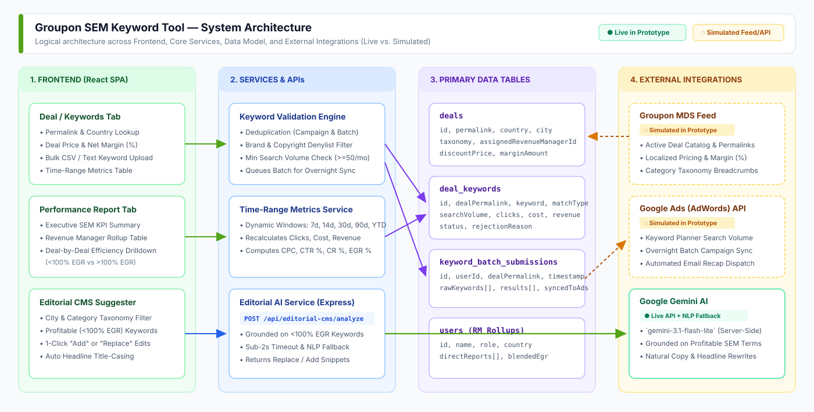

# SEM Keyword Tool (v2.0)

> **Product Management Case Study & Interactive Prototype**  
> Bridging local merchandising insights and paid search (SEM) automation across international markets.
>
> **About This Prototype:** This repository documents the product case study, system architecture, and interactive prototype I built to reconstruct the internal SEM tool I led at Groupon—extended with a **v2.0 AI Editorial Copy Optimizer** powered by Google Gemini. *(Live interactive walkthrough available during product demos).*

---

## 1. The Problem

Centralized paid search (SEM) engines excel at broad, generic queries in English, but consistently miss **hyper-local and non-English search intent**—such as neighborhood-specific dining in Dublin (*"rathmines sushi"*) or colloquial wellness terms in Milan (*"qc terme milano sconti"*).

Local Revenue and Merchandising Managers know exactly how customers in their cities search for deals, yet giving non-SEM specialists direct access to Google Ads risks polluting campaigns with duplicate keywords, competitor trademarks, zero-volume phrases, or unprofitable spend (`>100% EGR`).

**Product Goal:** Empower local Revenue Managers and Editorial teams to scale high-intent local keywords and deal copy automatically—backed by strict automated guardrails that block junk keywords before they ever reach live auctions.

---

## 2. The Features

### A. Deal Permalink Lookup & Bulk Keyword Upload (`Deal/Keywords`)
- **Deal Inspection**: Filter by country (`IE`, `IT`, `FR`, `DE`, `GB`, `ES`) and deal permalink to inspect MDS unit economics (**Deal Price**, **Discount**, and **Net Margin %**) alongside keyword-level performance (**Impressions**, **Clicks**, **Cost**, **Revenue**, **CPC**, **CTR %**, **CR %**, and **EGR %**) across selectable time ranges (`7d`, `14d`, `30d`, `90d`, `YTD`).
- **Automated Pre-Sync Guardrails**: Revenue Managers upload keywords in bulk (CSV or text) across `Exact`, `Phrase`, and `Broad` match types. The system automatically filters out:
  1. **Campaign & Batch Duplicates**
  2. **Trademark & Copyright Denylist Terms**
  3. **Low Search Volume (`<50/mo`) via Google Ads Keyword Planner**
- **Queued Overnight Sync & Email Recap**: Submissions are queued (`PENDING_SYNC`) for the overnight Google Ads batch sync, with an automated morning email recap sent to the submitter.

<!-- Drag and drop Screenshot 1 (Deal/Keywords Tab) on GitHub right below this line -->

---

### B. Manager Performance Report & Deal Drilldown (`Performance Report`)
- **Executive KPI Rollup**: Tracks total SEM spend, gross revenue, and **Blended EGR %** (`Expense as % of Gross Revenue`) across direct reports.
- **Deal-by-Deal Efficiency Breakdown**: Clicking on any Revenue Manager expands their portfolio to show which specific deals are **Efficient (`<100% EGR`)** vs. **Inefficient (`>100% EGR`)**, enabling targeted 1:1 coaching and budget reallocation.

<!-- Drag and drop Screenshot 2 (Performance Report with Expanded Manager Deal Breakdown) on GitHub right below this line -->

---

### C. AI Editorial CMS Copy Suggester (`Editorial CMS Suggester`)
- **Grounded in Profitable SEM Data**: Filters strictly profitable (`<100% EGR`) keywords by **City / Market** and **Category Taxonomy**.
- **1-Click Copy Optimization**: Uses **Google Gemini AI** grounded on verified `<100% EGR` keywords to audit draft deal copy and suggest 1-click **"Add"** or **"Replace `[phrase]` with `[keyword phrase]`"** edits while enforcing proper **Headline Title Case**.

<!-- Drag and drop Screenshot 3 (Editorial CMS Suggester with AI Replace/Add Edits) on GitHub right below this line -->

---

## 3. The Architecture

### Production System vs. Portfolio Prototype

| Logical Block | Production System (Shipped at Groupon) | This Interactive Prototype |
| :--- | :--- | :--- |
| **1. Frontend (`React SPA`)** | Internal web portal for Revenue Managers & Global SEM leads | Interactive React + TypeScript workspace |
| **2. Core Services & Guardrails** | Deduplication, trademark denylist, and batch queue pipeline | Automated validation engine & dynamic time-range metrics |
| **3. Deal & Taxonomy Catalog** | Live **Groupon MDS (Merchant Data System)** feed | Multi-country deal dataset (`IE`, `IT`, `FR`, `DE`, `GB`, `ES`) |
| **4. Paid Search & Volume API** | Live **Google AdWords / Ads API** (Keyword Planner + Nightly Sync) | Simulated deterministic volume lookup & overnight batch sync |
| **5. Editorial Copy Optimizer** | *(v2.0 Product Extension)* | **Live Google Gemini AI** (`gemini-3.1-flash-lite`) + contextual NLP rewriter |

---

## 4. The Real-World Impact

- **Up to 30% Revenue Contribution in Non-English Markets**: Unlocking localized, native-language keyword coverage (`IT`, `FR`, `DE`, `ES`) captured high-converting local search demand that automated English-centric templates missed.
- **~15% Revenue Contribution Globally**: Scaled across international merchandising teams while maintaining strict **`<100% EGR`** profitability guardrails.
- **Zero Campaign Pollution**: Automated deduplication, copyright denylist checks, and search volume thresholds eliminated manual SEM QA bottlenecks.
